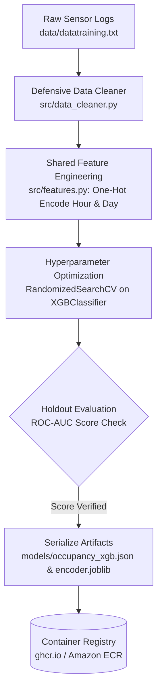

# Room Occupancy Prediction — MLOps Pipeline

An end-to-end, event-driven Machine Learning operationalization pipeline designed to predict room occupancy from environmental sensor telemetry (`Temperature`, `Humidity`, `Light`, `CO2`, and `HumidityRatio`). Based on real-time occupancy predictions, the service issues deterministic control directives to enable or disable room HVAC and lighting systems.

---

## 🏗 Repository Architecture & Structure

To prevent **training-serving skew**, feature extraction and datetime encoding are isolated in a shared module consumed by both the offline training pipeline and the online inference microservice.

```text
├── .github/workflows/
│   └── ci-cd.yml            # Automated linting, unit testing, and multi-image container builds
├── data/                    # Raw telemetry sensor datasets (datatraining.txt, datatest.txt, datatest2.txt)
├── models/                  # Serialized XGBoost JSON weights & fitted OneHotEncoder artifacts
├── src/
│   ├── __init__.py
│   ├── data_cleaner.py      # Defensive parser rectifying split rows, dot-delimiters, and schema typos
│   ├── features.py          # Shared datetime extraction & deterministic One-Hot Encoding (24h + 7d)
│   ├── train.py             # XGBoost Classifier training, RandomizedSearchCV, and ROC-AUC evaluation
│   └── main.py              # Event-driven FastAPI inference endpoint with Pydantic schema validation
├── tests/
│   └── test_pipeline.py     # Pytest suite verifying anomaly recovery, API responses, and 422 guardrails
├── Dockerfile.train         # Containerized batch training job
├── Dockerfile.serve         # Hardened, non-root runtime container for the FastAPI inference service
├── requirements.txt         # Pinned Python dependencies
└── README.md
```

---

## 🧠 Task 1: Model Training Pipeline Workflow

The training pipeline ingests raw, unaligned telemetry logs, repairs structural anomalies, engineers categorical time features, optimizes hyperparameters via Random Search, and validates model quality before exporting immutable artifacts.



### Key Engineering Guardrails
* **Syntactic Anomaly Recovery (`src/data_cleaner.py`):** Repairs multi-line record splits, dot-delimiter mutations merging timestamps with float readings, and misspelled column headers (`HumidityRatioi`) without crashing ingestion jobs.
* **Zero Training-Serving Skew (`src/features.py`):** Uses a deterministic `OneHotEncoder` pre-configured across all 24 hours (`0–23`) and 7 days (`0–6`) so inference payloads produce the exact same feature matrix shape regardless of event time.
* **Immutable Serialization (`src/train.py`):** Exports trained decision trees strictly to XGBoost's native JSON format (`occupancy_xgb.json`) rather than runtime-fragile Python pickle files.

---

## 🚀 Local Setup & Execution Guide

### 1. Environment Initialization
```bash
# Create and activate an isolated Python virtual environment
python3 -m venv .venv
source .venv/bin/activate

# Install dependencies
pip install --upgrade pip
pip install -r requirements.txt
```

### 2. Run the Training Pipeline
Execute the training script to clean the raw files, run `RandomizedSearchCV`, print the holdout **ROC-AUC** score, and generate the model artifacts inside `models/`:
```bash
python -m src.train
```

### 3. Execute Linting & Automated Unit Tests
Run `flake8` and `pytest` to verify data-cleaning resilience and API contract enforcement:
```bash
flake8 src/ tests/ --max-line-length=100
pytest -v
```

### 4. Start the Event-Driven Inference Service
Launch the FastAPI microservice locally on port `8080`:
```bash
uvicorn src.main:app --host 127.0.0.1 --port 8080 --reload
```

---

## 📡 Task 2: Event-Driven Inference API

### Liveness & Readiness Probe
* **Endpoint:** `GET http://localhost:8080/health`
* **Behavior:** Returns `200 OK` once `occupancy_xgb.json` and `encoder.joblib` are hydrated into RAM, or `503 Service Unavailable` if artifacts are missing.

### Event Prediction Webhook
* **Endpoint:** `POST http://localhost:8080/predict`

#### Sample Event Request:
```bash
curl -X 'POST' \
  'http://localhost:8080/predict' \
  -H 'accept: application/json' \
  -H 'Content-Type: application/json' \
  -d '{
    "timestamp": "2015-02-11 14:48:00",
    "temperature": 21.76,
    "humidity": 31.13,
    "light": 437.33,
    "co2": 1029.66,
    "humidity_ratio": 0.005021
  }'
```

#### Sample Actuator Response:
```json
{
  "occupancy_prediction": 1,
  "confidence_score": 0.99412,
  "actuator_directive": "ENABLE_HVAC_AND_LIGHTS"
}
```

---

## 🔄 Task 3: CI/CD & Continuous Training (CT) Architecture

### Automated CI/CD Pipeline (`.github/workflows/ci-cd.yml`)
Every push or pull request to `main` triggers a two-stage automated pipeline:
1. **Lint & Test Gate (`lint-and-test`):** Enforces PEP8 compliance via `flake8`, executes `src/train.py` to generate fresh artifacts, and validates all unit and schema tests via `pytest`.
2. **Dual Container Build & Push (`build-and-push-containers`):** Builds both `Dockerfile.train` (batch training image) and `Dockerfile.serve` (non-root Uvicorn runtime image) and pushes them to **GitHub Container Registry (`ghcr.io`)** using short-lived `GITHUB_TOKEN` permissions.

### Continuous Training (CT) Strategy
In a production factory environment, sensor calibration drift and seasonal weather shifts will gradually degrade model accuracy over time. To automate retraining safely without manual intervention, I would implement an asynchronous, out-of-band Continuous Training loop:

1. **Telemetry & Ground-Truth Logging:** The inference gateway asynchronously logs incoming feature payloads and predictions to an analytical data store (e.g., PostgreSQL/TimescaleDB or Amazon S3), paired with delayed ground-truth occupancy labels (from badge swipes or manual overrides).
2. **Automated Drift & Performance Monitoring:** A scheduled monitoring job runs statistical distribution checks (such as a **Kolmogorov-Smirnov test** on `CO2`, `Light`, and `Temperature`) comparing a 7-day rolling window against the baseline training distribution.
3. **Orchestrated Retraining Trigger:** When feature drift exceeds a defined threshold ($p < 0.05$) or rolling ROC-AUC drops below SLA limits, an orchestrator (**AWS Step Functions** or **Apache Airflow**) launches the containerized training job (`Dockerfile.train`) against the updated dataset.
4. **Automated Champion/Challenger Gate:** The newly trained candidate model is evaluated against a holdout validation set. Only if the challenger beats the active production model's **ROC-AUC** score is the new `occupancy_xgb.json` promoted to the artifact store (`S3`), triggering a rolling restart or zero-downtime reload of the serving containers.
